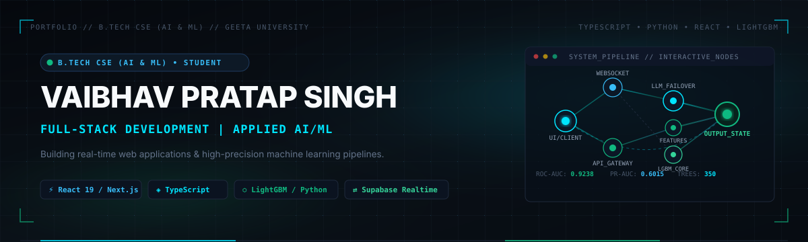

  

# Vaibhav Pratap Singh

### **B.Tech CSE (AI & ML) | Full-Stack Development | Applied AI/ML**

*Undergraduate engineering student at Geeta University (2025–2029) focused on real-time full-stack web applications, applied machine learning systems, and generative AI pipelines.*

  
  
  
  
  

---

### Navigation

[**About Me**](#-about-me) &bull; [**Technologies & Tools**](#-technologies--tools) &bull; [**Featured Projects**](#-featured-projects) &bull; [**Coding & Problem Solving**](#-coding--problem-solving) &bull; [**Current Technical Focus**](#-current-technical-focus) &bull; [**Connect**](#-connect)

---

## 🧭 About Me

I am a Computer Science & Engineering undergraduate specializing in **Artificial Intelligence & Machine Learning**. I enjoy building end-to-end applications where interactive user interfaces connect with resilient backend services and data-driven models.

### Primary Engineering Interests:
- 🌐 **Full-Stack Web Development**: Building responsive, performant user interfaces using **React 19**, **Next.js (App Router)**, and **TanStack Start**, backed by strict TypeScript typing, Tailwind CSS, and accessible UI primitives.
- ⬡ **Artificial Intelligence & Machine Learning**: Training and evaluating tabular classifiers on high-dimensional data using **LightGBM**, Scikit-Learn, and Python with leak-free chronological validation.
- ⚡ **Generative AI & Agentic Systems**: Integrating multi-provider LLM pipelines (**Google Gemini API**, **Groq**) with automated fallback chains, vision extraction, and deterministic heuristic safety layers.
- 🛠 **Building Useful Software Products**: Designing practical software solutions for real-world scenarios—from cooperative service marketplaces to physical event game engines.

---

## 🛠 Technologies & Tools

  

 

#### **Languages & Core**

  
  
  
  
  
  

#### **Frontend & UI Engineering**

  
  
  
  
  

#### **Backend, Realtime & Cloud**

  
  
  
  
  
  

#### **Applied AI, Machine Learning & Data**

  
  
  
  
  

---

## 🚀 Featured Projects

### 1. [Cinebid — Live Real-Time Movie & Cricket Auction Platform](https://github.com/Vaibhav-Singh22-ui/Cinebid)
> **Domain**: Real-Time Full-Stack Application &bull; **Live Demo**: [cinebid-ashen.vercel.app](https://cinebid-ashen.vercel.app)  
> **Stack**: TanStack Start &bull; React 19 &bull; TypeScript &bull; Supabase (Realtime & Presence) &bull; Tailwind CSS &bull; Recharts

* **Problem Solved**: Multiplayer auctions require sub-second bid coordination across clients, continuous purse budget updates, and automated portfolio evaluation without server desynchronization.
* **Verified Implemented Features**:
  * Real-time multi-client bidding rooms with WebSocket broadcast channels and synchronized countdown timers.
  * In-auction trading desk, host management controls, and purse re-usability flow.
  * Smart AI portfolio scoring engine evaluating movies on Critical Acclaim (IMDb), Box Office ROI, Genre Synergy, and Budget Efficiency with automated Groq/Gemini API calls and local heuristic fallbacks.
  * IPL cricket tournament simulation engine with team-balance calculations and match mechanics.
* **Status of Remaining Features**:
  * *Exists in Codebase (Pending Stress Testing)*: High-concurrency room recovery after sustained network dropouts.
  * *Planned / Future*: Persistent global leaderboards across multiple hosted tournament seasons.

---

### 2. FraudGuard / ScamShield AI — Production Transaction Fraud Inference Pipeline *(Local Research)*
> **Domain**: Applied Machine Learning & Inference API &bull; **Status**: Completed local validation, undergoing pre-release review  
> **Stack**: Python 3.11 &bull; LightGBM &bull; Scikit-Learn &bull; FastAPI &bull; Joblib &bull; Google Gemini API &bull; Groq API

* **Problem Solved**: Detecting financial transaction fraud in high-dimensional, imbalanced data streams while avoiding chronological future leakage and providing sub-second inference.
* **Verified Implemented Features**:
  * Champion LightGBM classifier (350 trees, 455 engineered features) trained on the IEEE-CIS Fraud Detection dataset.
  * 4-window chronological expanding validation on `TransactionDT`: validated **ROC-AUC of $0.9238 \pm 0.0097$** and **PR-AUC of $0.6015 \pm 0.0310$**.
  * Asynchronous FastAPI inference service exposing `/predict`, `/explain`, and `/analyze-image`.
  * Multi-provider GenAI failover orchestrator: Gemini (Primary) $\rightarrow$ Groq (Secondary) $\rightarrow$ OpenAI (Tertiary) $\rightarrow$ Deterministic Mock Fallback.
  * Vision/OCR extraction layer with strict allowlist sanitization and sensitive data redaction.
* **Status of Remaining Features**:
  * *Exists in Codebase (Local)*: Standalone review scripts and calibration curves.
  * *Planned / Future*: Frontend fraud analyst dashboard and containerized Docker deployment.

---

### 3. [Real-Life Nirogi Tanman — Integrative Healthcare & Wellness Platform](https://github.com/Vaibhav-Singh22-ui/Real-Life-nirogi-tanman-website)
> **Domain**: Health-Tech Web Platform &bull; **Live Demo**: [real-life-nirogi-tanman-website.vercel.app](https://real-life-nirogi-tanman-website.vercel.app)  
> **Stack**: Next.js (App Router) &bull; React &bull; TypeScript &bull; Supabase &bull; Tailwind CSS &bull; Radix UI

* **Problem Solved**: Bridges clinical care, personalized nutrition, and guided yoga therapy into a single unified patient management workflow.
* **Verified Implemented Features**:
  * Multi-role portal layout supporting Patients, Doctors, Nutritionists, and Yoga Instructors.
  * Interactive health assessment intake flow with condition-specific treatment plan displays.
  * Integrated AI conversational assistant providing proactive wellness and lifestyle recommendations.
  * Responsive UI built with Manrope/Inter typography and accessible Radix UI components.
* **Status of Remaining Features**:
  * *Exists in Codebase*: Database schemas for doctor-patient consultation scheduling.
  * *Planned / Future*: End-to-end encrypted medical record storage and automated tele-consultation video rooms.

---

### 4. [The Gauntlet (₹50 Challenge) — Live Event Trivia Engine](https://github.com/Vaibhav-Singh22-ui/the-gauntlet)
> **Domain**: Interactive Game Engine &bull; **Live Demo**: [the-gauntlet-eta.vercel.app](https://the-gauntlet-eta.vercel.app)  
> **Stack**: Next.js &bull; React &bull; TypeScript &bull; Supabase PostgreSQL &bull; Tailwind CSS &bull; Canvas Confetti

* **Problem Solved**: Event trivia games require deterministic server-side state enforcement to prevent client inspection of answers and ensure level progression fairness.
* **Verified Implemented Features**:
  * 15-tier prize ladder logic with per-question 60-second countdown timers.
  * Server-side random question selector querying a database bank of 1,000+ curated questions.
  * Hint system and 50:50 elimination lifelines, synchronized with audio sound effects.
  * Supabase schema migration and SQL seed scripts.
* **Status of Remaining Features**:
  * *Exists in Codebase*: Operator administrative panel for physical event coordination.
  * *Planned / Future*: Multi-booth live sync across multiple simultaneous game operators.

---

### 5. [MindRush / AP Games Live — Modular Aptitude & Cognition Engine](https://github.com/Vaibhav-Singh22-ui/ap-games-live-)
> **Domain**: Client-Side Cognitive Testing &bull; **Live Demo**: [ap-games-live.vercel.app](https://ap-games-live.vercel.app)  
> **Stack**: React &bull; TypeScript &bull; Vite &bull; Tailwind CSS &bull; Lucide React &bull; Canvas Confetti

* **Problem Solved**: Fast, responsive aptitude assessment requiring immediate client-side feedback without server round-trips.
* **Verified Implemented Features**:
  * 6 distinct aptitude game engines: Pattern Matrix, Spatial Reasoning, Speed Math, Verbal Logic, Memory Recall, and Sequence Solver.
  * 90 handcrafted progressive difficulty levels with instant state validation.
  * Local progress persistence and reactive countdown timers.
* **Status of Remaining Features**:
  * *Planned / Future*: Cloud-synced user profiles and percentile score benchmarks.

---

## 🏆 Coding & Problem Solving

* **LeetCode**: [vaibhav_thakur49](https://leetcode.com/u/vaibhav_thakur49/)
* **Codeforces**: [Vaibhav2225](https://codeforces.com/profile/Vaibhav2225)
* **Core Focus**: Data Structures & Algorithms, Dynamic Programming, Graph Traversal, and Array/String Manipulation in C++ and Python.

---

## 📚 Current Technical Focus

* 🔬 **Production ML Pipelines**: Learning robust feature preprocessing, data drift monitoring, and experiment tracking with MLflow.
* ⇄ **State & Network Resilience**: Studying WebSocket reconnection strategies and optimistic UI patterns under slow network conditions.
* 🛡 **Testing Fundamentals**: Practicing automated unit testing with Vitest/Pytest and end-to-end validation with Playwright.

---

## 📬 Connect

* **LinkedIn**: [linkedin.com/in/vaibhav-singh-62245837a](https://www.linkedin.com/in/vaibhav-singh-62245837a)
* **Email**: [vaibhavsingh9862@gmail.com](mailto:vaibhavsingh9862@gmail.com)
* **Portfolio**: [my-portfolio-three-tau-18.vercel.app](https://my-portfolio-three-tau-18.vercel.app)
* **GitHub**: [@Vaibhav-Singh22-ui](https://github.com/Vaibhav-Singh22-ui)
* **Education**: B.Tech in CSE (AI & ML), Geeta University (2025–2029)
* **Location**: India

---

  All project features, benchmarks, and deployment links verified against source code.

